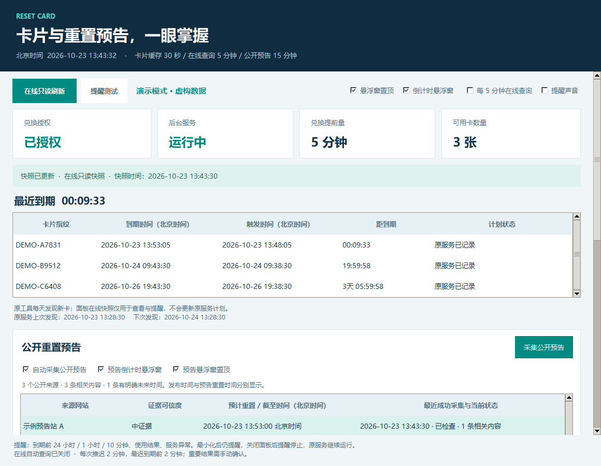
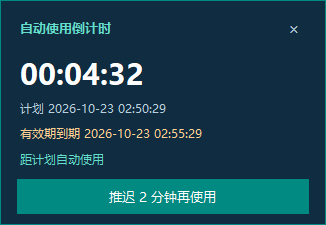
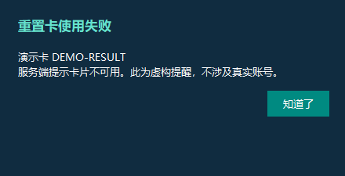
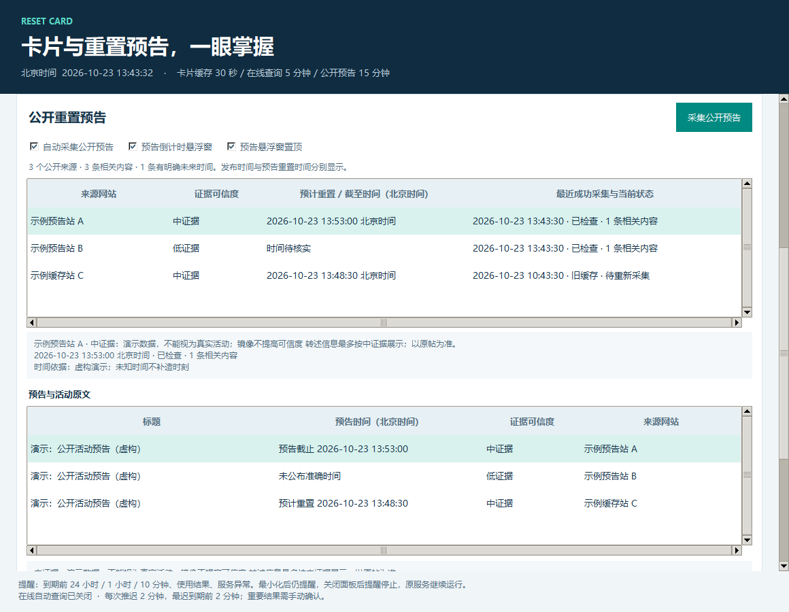
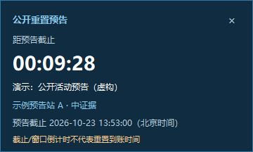

# Codex Reset Card Desktop · Windows 桌面增强版

中文桌面面板、重置卡提醒和右下角倒计时。为 [codex-reset-card](https://github.com/loccen/codex-reset-card) 提供独立桌面增强功能，当前已验证的后台版本为 **0.2.0**。

## 直接运行：不需要安装 Python

在 [Releases](https://github.com/hxroo6/codex-reset-card-desktop/releases/latest) 下载 Windows x64 ZIP，解压后双击 **CodexResetCardDesktop.exe**。EXE 包含 Python 与 Tcl/Tk 运行库。

**后台依赖仍需准备：**已经登录 ChatGPT 的 Codex CLI，以及 `codex-reset-card@0.2.0`。本面板不会替你登录，也不会自动授权消费卡片。

```powershell
npm install -g codex-reset-card@0.2.0
codexrc config set lead-time 5m
codexrc service install
```

安装服务不等于授权。需要自动使用时，单独执行 `codexrc arm`；停用时执行 `codexrc disarm`。授权范围包含当前和以后后台发现的卡片。

## 功能

- 卡片有效期、实际自动使用计划、倒计时、后台与授权状态。
- 右下角悬浮窗，显示与置顶独立开关，设置自动保存。
- 单卡每次推迟 **2 分钟**，至少保留到期前 **2 分钟**。下一次会越界时禁用；例如默认提前 5 分钟，可推迟到提前 3 分钟，再次点击将被拒绝。
- 成功、明确失败、此前已兑换和结果待确认分别提醒；重要结果需手动确认，不被普通提醒覆盖，未确认提醒可跨重启恢复。
- 后台版本检查：无法确认兼容性时可以查看状态，但禁止修改延期计划。
- 独立演示模式，不连接账号、不操作真实卡片。
- 多站公开活动预告：逐站显示证据可信度、预计时间、采集状态及错误；共同原帖去重。
- 单独的重置预告悬浮窗，显示与置顶可开关；明确的未来时间支持提前 1 小时、10 分钟、2 分钟和到点提醒。

## 公开重置预告

内置 **12 个**公开公告与历史来源：

| 来源 | 采集入口与用途 |
| --- | --- |
| [Codex Reset Radar](https://codex-reset.com/) | 公开公告 Feed |
| [Codex Resets](https://codex-resets.com/) | 公共状态 API |
| [WhenReset](https://whenreset.app/) | 公告与历史 JSON |
| [Skill2Web](https://reset.skill2web.com/zh/codex/) | 中文公告页公开数据 |
| [Codex Reset](https://codexreset.dev/) | 综合状态、原帖与历史 API |
| [Codex Reset App](https://codex-reset.app/) | 公开网页预告与活动 |
| [Tibo Watch](https://tibo.watch/) | 公告、预告与回复线索 API |
| [When Next Reset](https://whennextreset.com/) | RSS 历史与发卡记录补充 |
| [CodexClock](https://codexclock.com/) | 静态原帖与历史 JSON；按文件数据更新时间标明陈旧 |
| [WhenReset 中国](https://whenreset.com.cn/) | 公开预告 API，区分原帖、社区观察和模型窗口 |
| [WhenReset UK](https://whenreset.uk/) | 公开雷达 API，未审核候选不生成准确倒数 |
| [AI Resets](https://ai-resets.com/) | 公开中文网页预告与历史，不访问其受限 API |

默认每 15 分钟检查，单站异常退避并显示缓存状态，可关闭采集与提醒，也可单独关闭预告悬浮窗。来源列表可滚动。升级后自动加入新增站点，保留原缓存和提醒去重记录。

遇到连接、TLS、DNS 或超时错误，网络恢复后可点击“采集公开预告”重试，两次尝试至少间隔 60 秒。HTTP 401、403、429 等服务器响应仍遵守各站退避时间。每站详情显示错误原因和下次重试时间，操作记录只在来源异常或恢复时新增汇总。

部分站点共用 Codex Resets 等上游，逐站详情会说明采集链路，不把转载数量当作独立证据。历史补充源没有明确预告时不会生成未来倒计时。

网站标出的概率、建议时间或“已确认”标签不会直接升级为本程序的准确预告。原文有时区歧义时只展示站点预计时间并标待核实；页面记录时间也不冒充原帖发布时间。

在“公开重置预告”查看各站的证据可信度、原始公告、发布时间和预计重置时间。可信度为证据等级，**不是到账概率**；第三方转述未独立核验的原帖最高为中。多个站引用同一原帖仍是一份证据。

只有新鲜且时间明确的预告参与倒计时。截止时间标为“预告截止”，到点只代表预告时间已到，仍需等待完成证据。发布时间、重置卡有效期、历史平均间隔不会被当成下一次重置时间；“即将到来”、有时区歧义或已过期的信息会显示原因。

公共活动不代表个人账户已恢复，也不改变原自动使用卡片的计划。最小化面板可继续采集和提醒，关闭面板后暂停。网站结构变化或被限制访问会显示采集失败，保留旧数据并标明陈旧，不静默显示“没有活动”。

下图均为虚构演示数据：









## 运行条件与边界

- Windows 10/11 x64；电脑需开机、当前用户保持登录、网络与 Codex 登录有效。
- 原后台默认每 24 小时发现新卡；面板每 5 分钟在线查看，不会因此更新后台发现计划。
- 推迟按钮会短暂停止后台、持有同名互斥锁、核对并原子更新这一张卡的计划，再恢复并确认后台运行。它不执行立即兑换。
- 距执行不超过 30 秒、已在使用/重试、可能影响其他正在处理的卡片或状态不明时，禁止延期。
- 最小化主面板后继续提醒；关闭面板后提醒暂停，原调度服务继续运行。提醒是独立桌面浮窗，不是 Windows 通知中心 Toast。
- 普通查询失败会退避；401/403/429 暂停自动在线查询，处理后可手动刷新。
- 版本检查依据软件版本及状态 schema；当前只允许已验证的上游 **0.2.0** 执行延期。

## 快捷方式与可选自启动

解压的 EXE 文件夹或源码目录均可使用：

```powershell
# 只创建桌面快捷方式
powershell -NoProfile -ExecutionPolicy Bypass -File .\scripts\install-shortcuts.ps1
# 另加登录后最小化启动（由用户主动选择）
powershell -NoProfile -ExecutionPolicy Bypass -File .\scripts\install-shortcuts.ps1 -Startup
# 移除本安装创建的入口
powershell -NoProfile -ExecutionPolicy Bypass -File .\scripts\install-shortcuts.ps1 -Startup -Remove
```

脚本检测同名但不属于本安装的入口时会停止，避免覆盖其他程序。

## 从源码运行与开发

只有开发源码或打包时需要 Python 3.12+（包含 tkinter）；应用运行时只依赖标准库。双击启动器会寻找可用 Python，不再固定安装路径。

```powershell
python .\desktop\reset_card_panel.py
python .\desktop\reset_card_panel.py --demo
cd desktop
python -m unittest -v
python .\reset_card_panel.py --smoke-test --smoke-report ..\local\source-smoke.json
```

打包 EXE：

```powershell
python -m pip install -r requirements-build.txt
powershell -NoProfile -ExecutionPolicy Bypass -File .\scripts\build-windows.ps1
```

Windows GitHub Actions 会运行测试、演示窗口冒烟、构建 EXE，并移除 Python PATH 后验证独立 EXE 的内置运行库。

## 数据与许可证

本地设置、脱敏快照、提醒去重与未确认结果保存在 `%LOCALAPPDATA%\CodexResetCardPanel`。本面板不读取登录 token；在线请求由原 CLI 完成。不要公开提交本机日志、完整状态、登录文件或真实截图。

公开预告采集独立访问上述公开 HTTPS 来源，复用系统代理，不发送个人卡片或账户数据、不读取浏览器登录。预告缓存与提醒去重保存在本地 `forecasts.json`。

采用 MIT；上游来源与版权见 [NOTICE](NOTICE)、[上游 MIT 许可证](LICENSES/codex-reset-card.MIT)。这是社区工具，与 OpenAI 无隶属关系。更多见 [SECURITY.md](SECURITY.md)。
